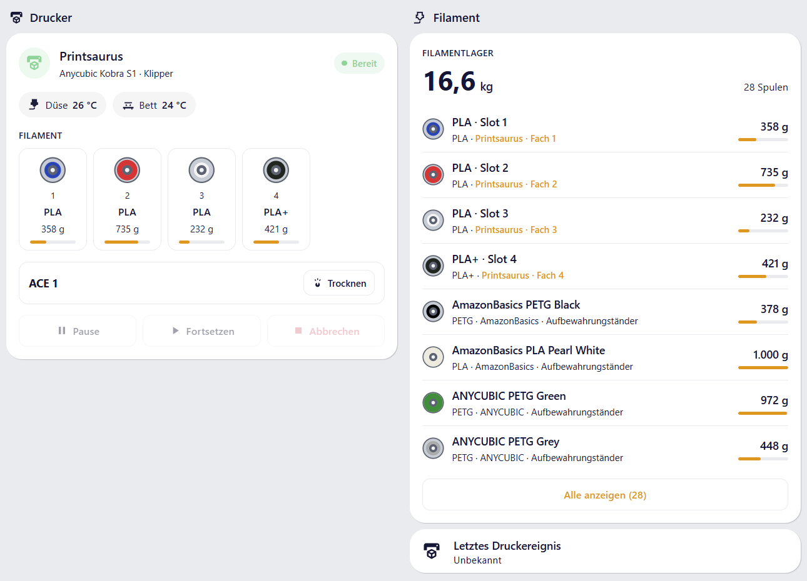
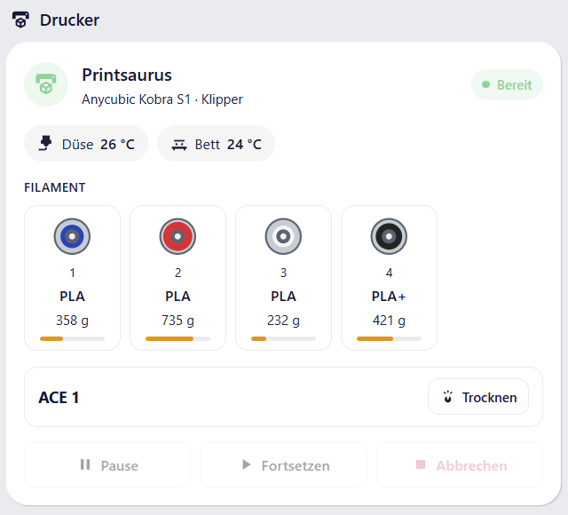
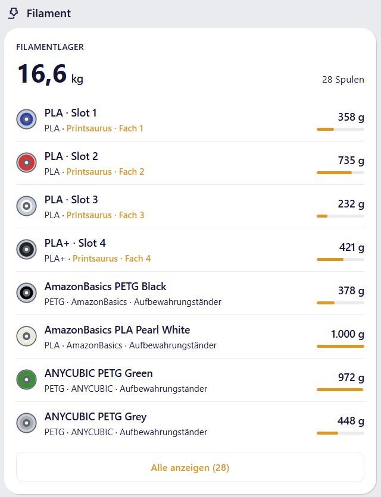

# 3DSEARCH Printers & Filament for Home Assistant

Brings your printers and filament stock from [3dsearch.net](https://3dsearch.net/filament/) into Home Assistant:
**Anycubic Cloud, Bambu Lab, Creality Cloud, Elegoo and Klipper** in one integration, together with the spools you manage on 3dsearch.net.



[](https://my.home-assistant.io/redirect/hacs_repository/?owner=nolimitek&repository=ha-3dsearch&category=integration)

## What you get

Per printer (one device each):

| Entity | |
|---|---|
| `sensor` Status | idle / printing / paused / error / offline |
| `sensor` Progress, Remaining time, Estimated end, Job, Current layer | while printing |
| `sensor` Nozzle / Bed temperature | |
| `sensor` Slot 1…n | remaining grams of the spool in that slot; material, colour, brand as attributes |
| `binary_sensor` Online, Printing, Problem | Problem = Klipper not ready (with the error message) |
| `button` Pause / Resume / Cancel print | Anycubic Cloud and Klipper only — Bambu Lab, Creality and Elegoo are read-only |
| `event` Print | `started`, `finished`, `failed` — for automations |
| `switch` ACE *n* drying | start/stop drying (ACE via Anycubic Cloud or Klipper with Rinkhals) using the two settings below |
| `number` ACE *n* drying temperature / duration | 35–55 °C, 1–24 h — kept in Home Assistant |
| `sensor` Box temperature / humidity / drying time remaining | ACE, AMS (Bambu AMS drying is shown, not controllable) |
| `sensor` Total prints / print time / filament | the printer's own lifetime counters, for printers that report them (Anycubic, Klipper) |
| `sensor` Next maintenance, `binary_sensor` Maintenance due | for printers with a maintenance plan on 3dsearch.net: how far the next task is (100 % = due), task and what is left as attributes |

For the account: **Spools in stock**, **Filament in stock**, **Spools almost empty** (with the list of spools), **Spools to dry** (open spools past the drying interval of their material), **Filament printed** (all-time, for long-term statistics), **Print costs this month** (filament, plus electricity and wear when set on 3dsearch.net), and **one sensor per spool** (remaining grams; brand, material, colour, storage location and — when loaded — printer and slot as attributes). Spools added on 3dsearch.net appear automatically; archived ones become unavailable.

The print event is based on the job history of 3dsearch.net, so a print that ends while Home Assistant restarts is still reported.

## Dashboard cards

The integration brings five cards along — no extra download, they appear in the card picker after the restart:



```yaml
type: custom:threedsearch-printer-card
device: <printer device>   # pick it in the visual editor
```

State, progress ring with remaining time and end, temperatures, the filament slots **in their real colours** with remaining grams, pause/resume/cancel (cancel needs a second tap), and one block per ACE/AMS with temperature, humidity and drying — start drying with presets (PLA 45 °C/4 h, TPU 50 °C/6 h, PETG 55 °C/6 h, ABS/ASA 55 °C/8 h) or your own values.

**Build your own layout:** in the visual editor you can switch every part of the printer card on or off. In YAML it looks like this (leave `hide` out to show everything):

```yaml
type: custom:threedsearch-printer-card
device: <printer device>
name: Workshop            # optional
hide: [temps, boxes]      # any of: head, image, job, temps, slots, boxes, boximage, buttons
```

Three small cards show a single part and fit next to each other:

| Card | Shows |
|---|---|
| `custom:threedsearch-job-card` | the running print with progress, remaining time and buttons |
| `custom:threedsearch-slots-card` | only the filament slots |
| `custom:threedsearch-box-card` | ACE or AMS with climate and, for ACE, drying |

They take the same `device` and `name` options. The print card also takes `hide: [head, image, buttons]`.

The printer picture is your own photo from 3dsearch.net, otherwise the picture from the manufacturer's cloud. Printers without either (Bambu, Klipper, Prusa) get a drawing that moves while they print. ACE, AMS and other filament boxes are drawn with their spools in the real colours; the running slot feeds filament, and a drying box shows rising heat. The box card takes `hide: [boximage]`.



```yaml
type: custom:threedsearch-stock-card
```

Filament in stock and all your spools with colour, remaining grams and where they are (printer slot or storage location). Almost empty spools come first; with many spools the list folds after 8 rows (`rows: 12` to change).

## Sidebar: the whole workshop inside Home Assistant

Since 0.5.0 the integration adds a **3DSearch** entry to the sidebar. It opens the complete Printers & Filament workshop from 3dsearch.net – printers, spools, slicer and print queue – right inside Home Assistant, in the colours and font of your Home Assistant theme. It works in the browser and in the companion app.

- Only Home Assistant **administrators** see the entry.
- Don't need it? Turn off **Show 3DSearch in the sidebar** under Settings → Devices & services → 3DSEARCH → Configure. The entry disappears right away, the sensors and cards stay.
- It signs in with a short-lived token that the integration fetches with your key. The key never reaches the browser and no 3dsearch.net cookie is needed.
- Printing labels and exporting open a new browser window with the normal 3dsearch.net sign-in.

## Installation

1. HACS → ⋮ → **Custom repositories** → add `https://github.com/nolimitek/ha-3dsearch`, type **Integration**.
2. Install **3DSEARCH Printers & Filament** and restart Home Assistant.
3. On [3dsearch.net](https://3dsearch.net/filament/#settings) open **Printers & Filament → Settings → Home Assistant** and create a key.
4. In Home Assistant: **Settings → Devices & services → Add integration → 3DSEARCH** and paste the key.

The key gives read access to your printers and spools and can pause/resume/cancel prints. You can revoke it on 3dsearch.net at any time.

## Example automation

```yaml
triggers:
  - trigger: state
    entity_id: event.printsaurus_print
    attribute: event_type
    to: finished
actions:
  - action: notify.mobile_app_phone
    data:
      message: "{{ state_attr('event.printsaurus_print', 'job_name') }} is done"
```

## Notes

- Home Assistant polls every 60 seconds (adjustable in the integration options, 30–600 s). Printer clouds are synced by 3dsearch.net at most once a minute, so this is not a real-time integration.
- A printer you remove on 3dsearch.net stays in Home Assistant with unavailable entities. Delete it on its device page (⋮ → Delete); current printers and the 3DSEARCH account device can't be deleted.
- Printers & Filament is in beta on 3dsearch.net.

## Deutsch

Drucker und Filamentlager von [3dsearch.net](https://3dsearch.net/filament/) in Home Assistant. Installation über HACS (benutzerdefiniertes Repository, Typ Integration), danach auf 3dsearch.net unter **Drucker & Filament → Einstellungen → Home Assistant** einen Schlüssel erstellen und in Home Assistant bei **Integration hinzufügen → 3DSEARCH** einfügen. Ab 0.5.0 gibt es in der Seitenleiste den Eintrag **3DSearch** mit der ganzen Werkstatt (Drucker, Spulen, Slicer, Druckwarteschlange) im Design deines Home-Assistant-Themes – sichtbar für Administratoren; unter **Geräte & Dienste → 3DSEARCH → Konfigurieren** lässt sie sich abschalten. Ab 0.6.0 kannst du im Karten-Editor jeden Teil der Druckerkarte ein- und ausblenden, dazu kommen drei kleine Karten für den aktuellen Druck, die Filamentfächer und die Filamentbox. Die Integration ist auf Deutsch, Englisch, Französisch, Spanisch, Italienisch und Niederländisch übersetzt. Drucker, die es auf 3dsearch.net nicht mehr gibt, lassen sich auf ihrer Geräteseite löschen (⋮ → Löschen).

## License

GPL-3.0 — see [LICENSE](LICENSE).
